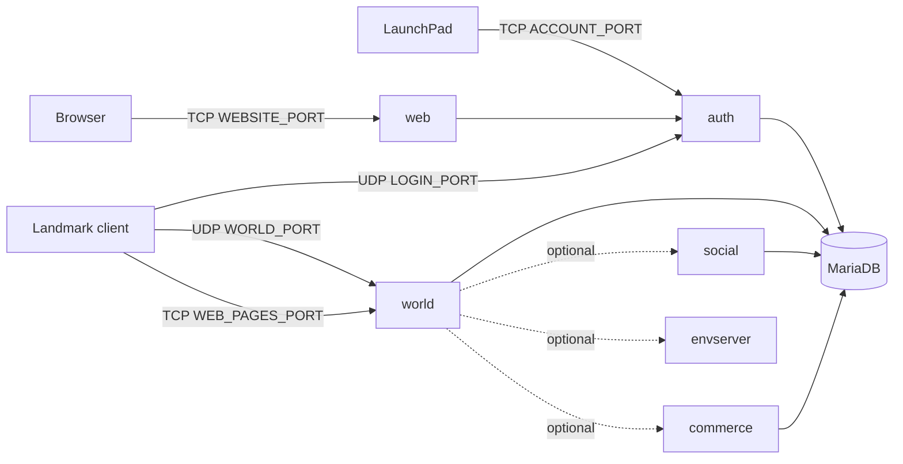

# Server Installation

LandmarkEmu runs with **Docker Compose** from the project folder: the settings are in one file, `.env`, and one
command starts everything.

- [Installation on Windows](Server-Installation-Windows): Docker Desktop, optionally `start.bat`.
- [Installation on Linux](Server-Installation-Linux): Docker Engine and `docker compose`.

This page explains what runs, the ports, and the parts that are the same everywhere.

## What runs

| Container | What it is |
|---|---|
| `setup` | Copies the data tables from your Landmark folder into `server-data/gamedata` ([Game Data](Game-Data)), then exits. Runs at every start; the servers wait for it |
| `db` | MariaDB: accounts and the server list (`lmemu_auth`), the shared characters (`lmemu_character`), each world's own database (`lmemu_world_<WORLD_KEY>`) |
| `auth` | The login server, and the account service LaunchPad and the website talk to (accounts, server info, news, the update) |
| `web` | The account sign-up website |
| `world` | The first world: a "server" in the game's list (Serenity by default). Characters are shared between worlds; build sites, props and terrain are each world's own |

Optional parts, as live Landmark split its servers (each is **being built**; off unless you switch it on):

| Container | Switched on by | What it does |
|---|---|---|
| `social` | `COMPOSE_PROFILES=social` and `SOCIAL_ADDRESS=social:20200` | Presence, friends, ignore lists, guilds, groups, chat routing and mail shared by every world |
| `commerce` | add `commerce` to `COMPOSE_PROFILES`, `COMMERCE_ADDRESS=commerce:20400` | Player Studio, contests, portraits and Showcase following shared by every world |
| `envserver` | add `envserver` to `COMPOSE_PROFILES`, `ENVSERVER_ADDRESS=envserver:20500` | The first world's terrain store (Environment Server) in its own container |
| gateway, world channel | their own compose files (`docker/gateway`, `docker/worldchannel`) | The client-facing connection of a world in its own container, so players stay connected while the world restarts; and the world-wide requests channel |

Each optional service copies the data it takes over once, on its first start: **back up first**. The details of each
are in `docs/docker.md` in the repository and in the [Settings Reference](Settings-Reference).



## Ports

Players need every port but `DB_PORT` open in the firewall (and forwarded on the router for players outside your home
network). Each can be changed in `.env`.

| Setting | Default | Protocol | What |
|---|---|---|---|
| `LOGIN_PORT` | 20042 | UDP | The login server: the game logs in here |
| `ACCOUNT_PORT` | 5000 | TCP | The account service: LaunchPad and the website create accounts and log in here |
| `WORLD_PORT` | 19000 | UDP | The game world |
| `WEB_PAGES_PORT` | 19001 | TCP | The in-game web pages: Showcase, store, Player Studio |
| `WEBSITE_PORT` | 8080 | TCP | The account sign-up website |
| `DB_PORT` | 3307 | TCP | The database, on this PC only (`127.0.0.1`), for tools such as HeidiSQL. Never open it to others |

The optional services talk to each other on Docker's internal network only (ports 20200, 20210, 20300, 20310, 20400,
20500); nothing there is published.

## The settings file

Copy `.env.example` to `.env` and fill in at least:

| Setting | |
|---|---|
| `GAME_DIR` | Your Landmark folder, the one with `Landmark64.exe` (forward slashes). Build 0.695 ([Game Data](Game-Data)) |
| `DB_ROOT_PASSWORD`, `DB_PASSWORD` | Two long random passwords (letters and digits), set **before the first start**: the database keeps the ones it was created with. Only the containers use them |
| `PUBLIC_HOST` | The address players on other PCs use to reach this PC; empty = this PC only |
| `ADMIN_ACCOUNT` | Optional bootstrap admin (`account:<name>`); prefer the auth DB `admin` table ([Account Creation](Account-Creation#admins)) |

Every other setting is explained in `.env.example` and in the [Settings Reference](Settings-Reference). Game settings
default to how live Landmark played; change any of them for your server. After changing `.env`, run
`docker compose up -d`: only the containers whose settings changed are recreated.

## Everyday commands

Run them in the project folder:

| Command | |
|---|---|
| `docker compose up -d --build` | First start, and after updating the code |
| `docker compose up -d` | Start, or apply changed settings |
| `docker compose down` | Stop (all data stays) |
| `docker compose logs -f world` | The world's console (`auth` for the login server; Ctrl+C leaves) |
| `docker compose restart world` | Restart the world |

The world is ready about a minute after it starts. It registers itself in the server list, and LaunchPad shows it as
up.

## Players on other PCs

1. Put the address they reach this PC on in `.env` as `PUBLIC_HOST`:
   - on your home network: this PC's LAN address (`ipconfig` on Windows, `ip addr` on Linux);
   - friends elsewhere: a VPN such as Tailscale or ZeroTier, where everyone joins your network and you use the
     address it gives this PC (the easiest and safest way), or your public IP address or host name with the ports
     forwarded on your router.
2. Run `docker compose up -d`.
3. Open the ports above in the firewall (and forward them on the router when not using a VPN).
4. Tell your players the address. They add it in LaunchPad.

The world tells every game client `PUBLIC_HOST`, so it must be an address *they* can reach: a player who gets stuck on
the loading screen usually means `PUBLIC_HOST` is wrong or UDP `WORLD_PORT` is blocked.

## More worlds

1. Copy `docker/worlds/extra-world.env.example` to, for example, `docker/worlds/liberation.env` and set its own
   `WORLD_KEY` (database and folder name), `WORLD_ID` (unique, never reused), `WORLD_NAME_ID` (its name in the server
   list, e.g. 560912 Liberation; the list of names is in `.env.example`), and its own free `WORLD_PORT` and
   `WEB_PAGES_PORT` (e.g. 19010 and 19011).
2. With the project running, start it:

   ```
   docker compose --env-file .env --env-file docker/worlds/liberation.env -p landmarkemu-world-liberation -f docker/world/docker-compose.yml up -d
   ```

   On Windows, `start.bat` starts and stops every world in `docker/worlds` along with the rest.
3. Open its two ports too. Players see it in the server list after logging in again.

To travel between worlds from the in-game teleport window, the worlds share one gateway: see `docs/docker.md`
("Travel between worlds").

## Your data and backups

| Where | What |
|---|---|
| Docker volume `landmarkemu_db` | Every database: accounts, characters, each world's build sites and props |
| `server-data/worlds/<WORLD_KEY>/` | Each world's files: terrain edits, screenshots, contests, reports, felled trees and gathered nodes, its `console.log` and `dev_commands.txt` |
| `server-data/gamedata/` | The copied game data (made again at every start) |

Back up both the `server-data` folder and the database, for example:

```
docker exec landmarkemu-db-1 mariadb-dump -uroot -p --all-databases > backup.sql
```

`docker compose down -v` **deletes the database volume**; `server-data` stays.

## Scheduled restarts

`RESTART_SCHEDULE` in `.env` (empty = none; live restarted on `Mon,Sat 03:00` Pacific time). Players get the game's
own warnings from an hour before, go back to character select at the end, and the world starts again by itself.
